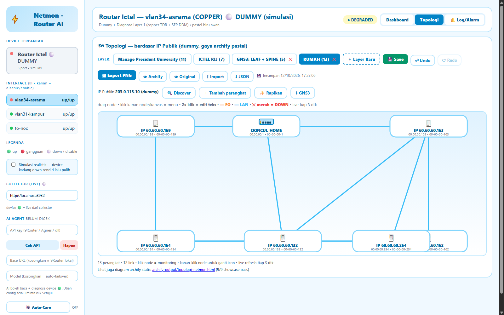
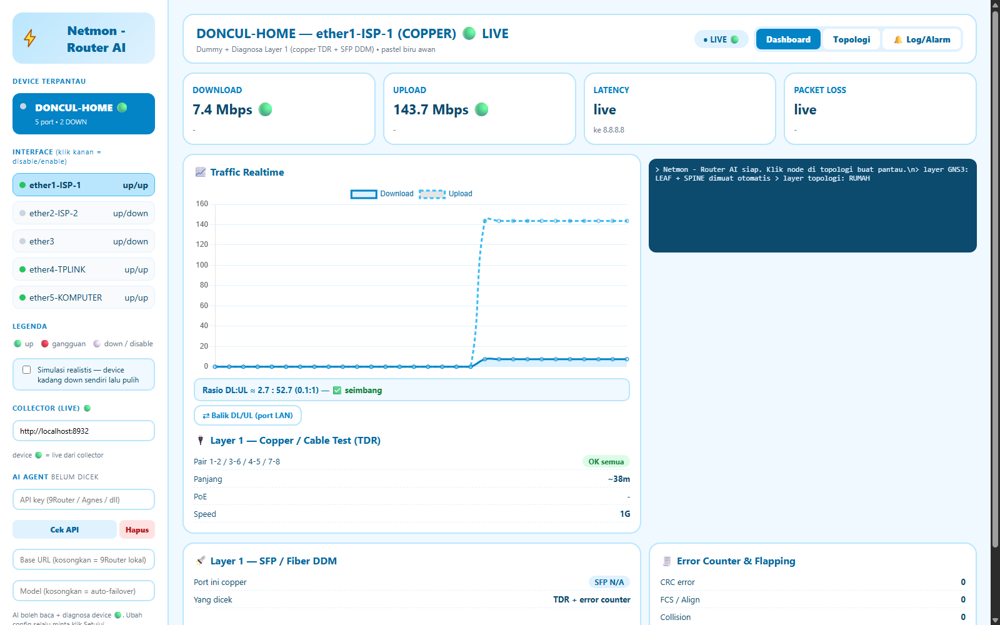

# Netmon - Router AI

Monitoring jaringan pastel biru awan: topologi per layer, traffic realtime (RouterOS API + SNMP), discovery otomatis, export diagram Archify, dan AI troubleshoot (analyzer + eksekusi seizin user).

*Topologi RUMAH hasil Discover — 13 perangkat, 1 router live.*

*Traffic realtime ether1-ISP-1 (DONCUL-HOME) pas speedtest jalan.*

## Isi repo

- `index.html` — dashboard + topologi (single-file, buka langsung)
- `collector/` — backend Node.js (bridge ke device, AI, scan, export)
- `start-netmon.bat` — dobel-klik: collector + dashboard jalan bareng
- `review/` — screenshot
- `netmon-dummy.html` — salinan `index.html` (cadangan)

## Jalanin

1. Dobel-klik `start-netmon.bat` (collector nyala + browser kebuka).
2. Tab Topologi → **🔍 Discover** → pilih subnet → Scan → centang → tambah ke layer.
3. Klik node → monitoring + traffic realtime (🟢 = live, ⚪ = dummy/simulasi).
4. Klik kanan node → **🔍 Cek device** (analyzer lokal, tanpa AI key) / **⚡ AI Troubleshoot** (butuh API key di sidebar).

## Aturan main

- AI boleh baca + diagnosa device 🟢. Ubah config **selalu** klik Setujui + login tulis (sekali pakai, tidak disimpan). Path `user/reset/reboot` diblokir permanen.
- Kredensial (`collector/.env`, API key browser) tidak pernah di-commit.
