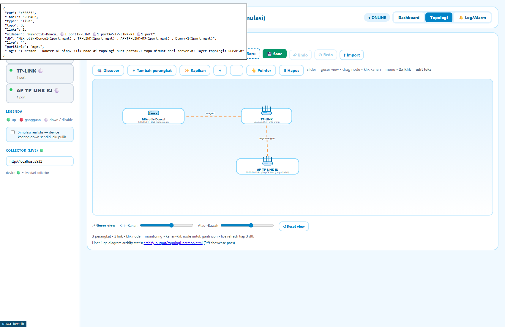
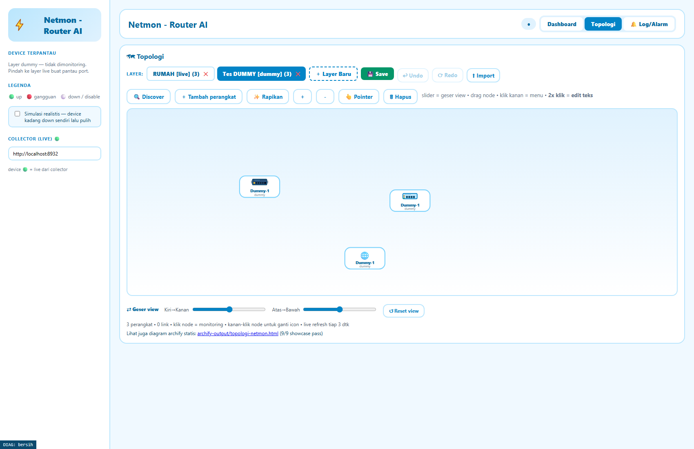

# Netmon — Router AI

Monitoring jaringan + topologi + AI troubleshoot. Install di mana, dipakai di
situ (ala PRTG): dashboard + collector jalan di mesin yang sama, topologi +
database tersimpan lokal di `data/topo.json`.

*Layer **live** (RUMAH): device asli terdeteksi via SNMP/ping, ikon sesuai jenis, status per node.*

*Layer **dummy** ala Packet Tracer: tambah bebas, tarik kabel, label teks, animasi traffic.*

## Jalanin

1. Dobel-klik `start-netmon.bat` (collector nyala di :8932 + browser kebuka).
2. Tab Topologi → **＋ Layer Baru** → pilih tipe:
   - **live** — device asli (add by jenis → klik kanan → isi IP → discover).
     Kabel langsung attach device-ke-device. Port mati = kabel merah.
   - **dummy** — ala Packet Tracer (tambah bebas, konek kabel = pilih port,
     traffic simulasi + animasi kabel).
3. Tab Dashboard → klik nama device (sidebar) → port muncul di bawah grafik
   → klik port → traffic port itu live. Mini topologi di bawah ikut sinkron.

## Aturan main

- 1 layer = 1 tipe (live|dummy), tidak bisa campur/diubah.
- Jalur live tanpa data karangan: discover gagal = node merah, betulkan IP-nya.
- Discovery segmen: tab Topologi → 🔍 Discover → pilih /24 → centang (+Pilih
  semua) → tambah ke layer live aktif.
- Kabel: klik node asal (Pasang kabel) → tarik → klik tujuan. Klik kabel =
  edit/hapus/pindah colok. Undo/redo + Rapikan tersedia.
- Label teks ala draw.io: klik kanan node → **✎ Edit nama & sub-teks** +
  ukuran font (A-/A/A+). Posisi node bebas di-drag.
- Remote akses: klik kanan node → **🖥 Remote** — HTTPS/HTTP/Telnet/SSH/Winbox
  langsung ke device (deteksi port otomatis via collector). Butuh handler
  sekali saja: `scripts\install-remote-handlers.bat`.
- Pindah mesin: copy `data/topo.json` (backup otomatis `data/topo.json.bak`).
  Export/Import JSON juga tersedia di tab Topologi.

## Kredensial

`collector/.env` (JANGAN commit) — lihat `collector/.env.example`.
AI boleh baca + diagnosa device 🟢. Ubah config selalu klik Setujui.
